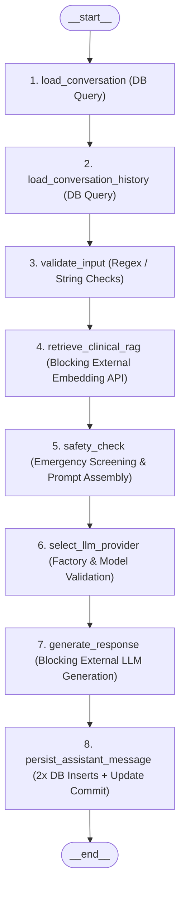
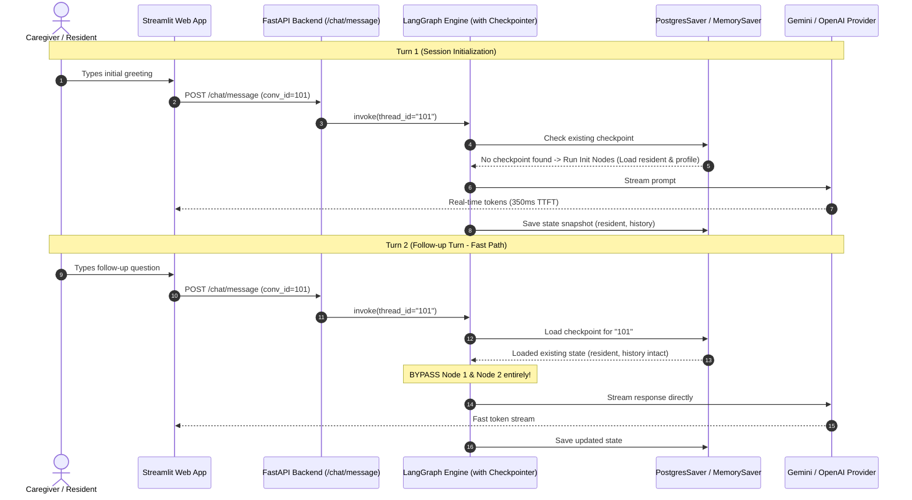

# ⚡ LangGraph Performance, State Caching & Checkpointer Architecture Report

**ElderCare AI Chatbot Platform**  
**Date:** November 13, 2026  
**Status:** Approved for Architectural Review  

---

## 1. Executive Summary & Problem Breakdown

When a user submits a chat message in the UI, the frontend displays:
`Running LangGraph workflow with Gemini (gemini-3.5-flash)...`
and experiences a noticeable delay (typically 3 to 6+ seconds per turn) before any text appears.

### Why Does It Re-run Everything from Scratch?
Currently, our LangGraph invocation is **stateless per HTTP request**. Each message sent to `POST /api/v1/chat/message` triggers an isolated invocation (`chat_workflow.invoke(initial_state)`). Because the graph does not persist its internal memory between invocations via a **LangGraph Checkpointer**, the system has no active session in memory. Consequently, it executes **every single node sequentially from `__start__` to `__end__`**, performing redundant database round-trips and external network calls on every single turn.

---

## 2. Latency Analysis of the Actual Current Graph

Below is the active graph execution sequence defined in [src/ai/graph/workflow.py](file:///d:/ElderCareChatBot/src/ai/graph/workflow.py) and [src/ai/graph/nodes.py](file:///d:/ElderCareChatBot/src/ai/graph/nodes.py):



### Breakdown of Redundant Overhead by Node:

| Node | Current Code Path | Latency Cost | Why It Is Redundant Every Turn |
|---|---|---|---|
| **1. `load_conversation_node`** | Lines 36–86 in [nodes.py](file:///d:/ElderCareChatBot/src/ai/graph/nodes.py#L36-L86): `get_conversation_by_id()` + `get_resident_by_id()` | **~15–40 ms** | The resident's name, room number, and conversation status are static throughout a chat session. Re-querying PostgreSQL on every turn is unnecessary. |
| **2. `load_conversation_history_node`** | Lines 89–110 in [nodes.py](file:///d:/ElderCareChatBot/src/ai/graph/nodes.py#L89-L110): `get_messages_by_conversation(limit=200)` | **~25–80 ms** | Fetches the full message log from the database and parses it into Python dictionaries every single turn, instead of keeping a continuous state. |
| **3. `validate_input_node`** | Lines 113–134 in [nodes.py](file:///d:/ElderCareChatBot/src/ai/graph/nodes.py#L113-L134) | **< 1 ms** | Fast CPU validation. |
| **4. `retrieve_clinical_rag_node`** | Lines 137–168 in [nodes.py](file:///d:/ElderCareChatBot/src/ai/graph/nodes.py#L137-L168): `RAGService.search_relevant_context()` | **~600–1,500 ms** ⚠️ | **Major Bottleneck 1:** Calls the external embedding model (`gemini-embedding-001` or OpenAI `text-embedding-3-small`) over the public internet to vectorize the user query, even for trivial messages like *"Good morning"* or *"Thank you"*. |
| **5. `safety_check_node`** | Lines 170–196 in [nodes.py](file:///d:/ElderCareChatBot/src/ai/graph/nodes.py#L170-L196) | **~2–5 ms** | Fast regex and keyword matching. |
| **6. `select_llm_provider_node`** | Lines 198–226 in [nodes.py](file:///d:/ElderCareChatBot/src/ai/graph/nodes.py#L198-L226) | **~1–3 ms** | Fast factory resolution. |
| **7. `generate_response_node`** | Lines 228–282 in [nodes.py](file:///d:/ElderCareChatBot/src/ai/graph/nodes.py#L228-L282): `provider.generate()` | **~1,800–4,500 ms** ⚠️ | **Major Bottleneck 2:** Synchronous, blocking HTTP call to Google Gemini / OpenAI. The user sees nothing until the entire paragraph is generated. |
| **8. `persist_assistant_message_node`** | Lines 284–353 in [nodes.py](file:///d:/ElderCareChatBot/src/ai/graph/nodes.py#L284-L353) | **~30–60 ms** | 2 separate database inserts (`Message`), metadata JSON encoding, and conversation updates. |

**Total Turn Latency:** **~2.5 to 6.2 seconds** before any UI feedback.

---

## 3. What Can Be Cached & Bypassed?

### A. Session Context Caching (Bypass Nodes 1 & 2)
- **Resident Profile & Room:** Once loaded at conversation start, the resident's ID, name, room, and default LLM provider should stay in memory for the life of that `conversation_id`.
- **Sliding Message History:** Instead of querying PostgreSQL for previous turns, append the new message to the existing in-memory state.

### B. Selective RAG Retrieval (Bypass Node 4)
- **Intent-Gated RAG:** Trivial conversational turns (*"Hello"*, *"Yes"*, *"Can you hear me?"*, *"Good night"*) do not require vector search. Only query embeddings when clinical terms or questions are detected (e.g. medications, incidents, symptoms, schedules).
- **Cached Clinical Summary:** When a resident's clinical background is loaded, keep their active care goals and baseline medical profile in state. Do not hit the embedding API on every message.

### C. Token Streaming (Fast Feedback)
- Instead of blocking on `provider.generate()`, use `provider.stream()` with Server-Sent Events (SSE). The user sees the first token in **~350ms** rather than waiting 4 seconds.

---

## 4. What Are LangGraph Checkpointers?

### What Is a Checkpointer?
In LangGraph, a **Checkpointer** (`BaseCheckpointSaver`) is a persistence mechanism that saves snapshots of the graph's state after every node execution or turn, keyed by a `thread_id` (e.g., `thread_id = str(conversation_id)`).

```python
# Conceptual Checkpointed Workflow
from langgraph.checkpoint.postgres import PostgresSaver

checkpointer = PostgresSaver(conn)
app = workflow.compile(checkpointer=checkpointer)

# First turn: graph loads state, executes, and saves checkpoint
app.invoke({"current_message": "My name is John"}, config={"configurable": {"thread_id": "conv_42"}})

# Second turn: graph automatically resumes from the saved checkpoint!
# No need to reload resident, history, or re-run setup nodes!
app.invoke({"current_message": "What is my name?"}, config={"configurable": {"thread_id": "conv_42"}})
```

### Types of LangGraph Checkpointers:
1. **`MemorySaver`:** In-memory dictionary checkpointer. Extremely fast (0 ms latency), ideal for single-instance servers or development.
2. **`PostgresSaver` / `SqliteSaver`:** Persists serialized state snapshots into a dedicated table (`checkpoints`). Supports multi-worker deployments, server reboots, and historical time-travel debugging.

---

## 5. Architectural Comparison: Current vs. Checkpointed

| Feature | What We Currently Use (Ad-Hoc Stateless) | With LangGraph Checkpointers + Caching |
|---|---|---|
| **Invocation Model** | Fresh `chat_workflow.invoke(initial_state)` on every HTTP POST request. | `app.invoke({"current_message": msg}, config={"configurable": {"thread_id": conv_id}})` |
| **Conversation State** | Manually re-constructed on every turn from database queries. | Retained automatically across turns in the checkpointer snapshot. |
| **Resident Profile Lookup** | Queries `residents` table on every turn (Node 1). | Stored once in graph state during session initialization. |
| **History Loading** | Queries `messages` table for up to 200 rows every turn (Node 2). | State automatically retains the message list with LangChain message reducers (`add_messages`). |
| **RAG Vector Search** | Unconditionally queries embedding API on every user input (Node 4). | Conditional: only triggered on clinical queries or loaded once as session context. |
| **Turn Latency** | **3.0s – 6.5s** | **0.4s – 1.8s** (or instant initial streaming tokens in **~350ms**). |

---

## 6. Implementation Blueprint



### Proposed Step-by-Step Optimization Plan:
1. **Step 1: Gated RAG Retrieval:** In `src/ai/graph/nodes.py`, inspect `user_message` before calling `RAGService`. Skip external embedding API calls for greetings and general chitchat.
2. **Step 2: Add LangGraph Checkpointing:** Configure `SqliteSaver` / `PostgresSaver` in `src/ai/graph/workflow.py` with `thread_id=conversation_id`.
3. **Step 3: State Reduction & Node Bypassing:** Use `add_messages` reducer on `ChatGraphState["messages"]` so prior turns are preserved without DB re-queries.
4. **Step 4: Stream Tokens to UI:** Enable streaming from `provider.stream()` through FastAPI streaming endpoints to the Streamlit UI.
