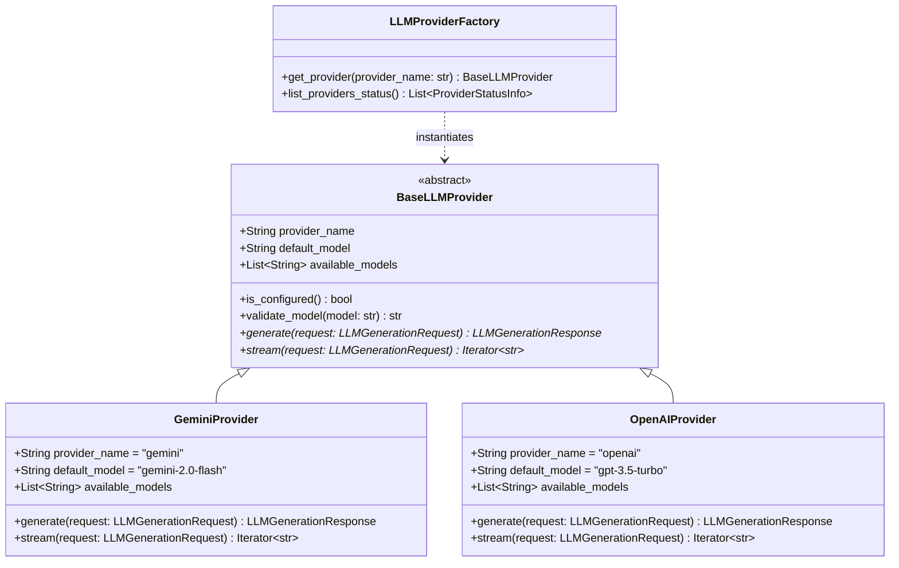
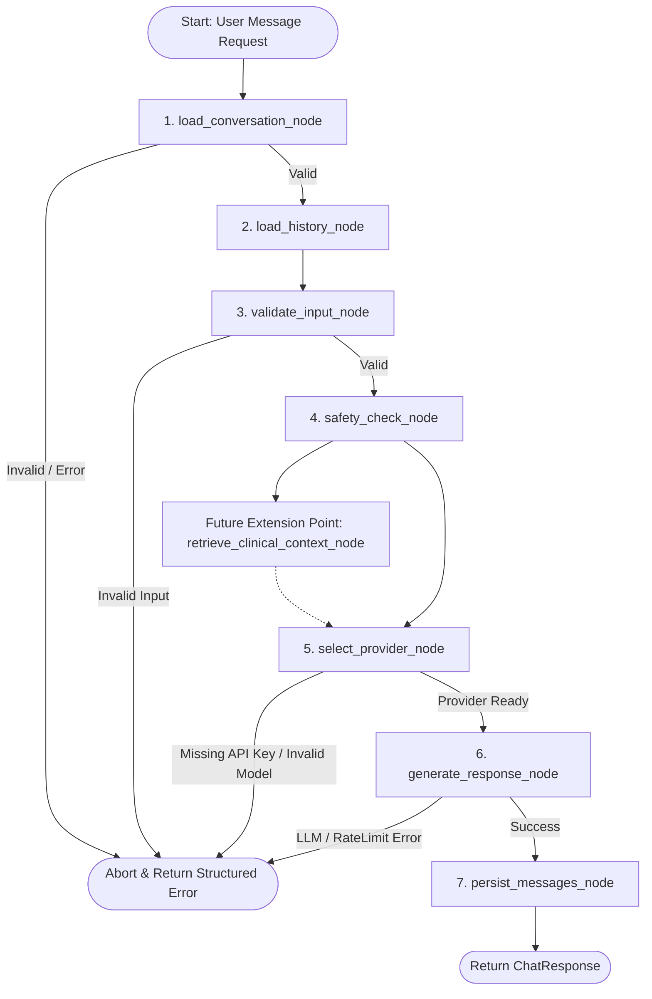
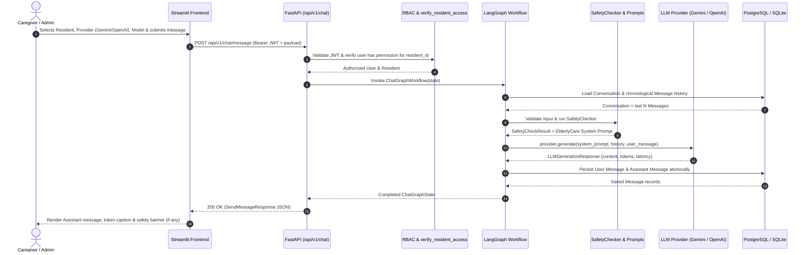

# 📐 Technical Architecture & Implementation Plan: Multi-Provider LLM System (LangGraph) & Streamlit Frontend

**Project:** ElderCareChatBot  
**Role:** Senior AI Engineer, Backend Architect & AI Application Developer  
**Document Version:** 1.0.0  
**Status:** Phase 1 Complete — Pending Review & Approval (No Application Code Modified)

---

## 1. Existing Architecture Assessment

### 1.1 Current Backend State
Based on a complete inspection of the repository, **ElderCareChatBot** currently operates as a modular, production-grade **FastAPI** backend with **SQLAlchemy 2.0**, **Pydantic v2**, **Alembic**, and **JWT + RBAC** security:

* **Entrypoint & Middleware (`src/main.py`):** Configures lifespan database connectivity checks, CORS middleware, request-duration logging middleware (`log_requests_middleware`), and global exception handlers that prevent internal stack traces from leaking to clients.
* **Configuration (`src/core/config.py`):** Uses `pydantic-settings` (`BaseSettings`) loading from `.env` with typed defaults (`DATABASE_URL`, `SECRET_KEY`, `JWT_ALGORITHM`, `ACCESS_TOKEN_EXPIRE_MINUTES`, `LOG_LEVEL`, `API_V1_PREFIX`).
* **Authentication & Authorization (`src/core/security.py`, `src/api/deps.py`):**
  * Bcrypt password hashing and PyJWT token generation/validation.
  * Two-tier RBAC (`Role.ADMIN` and `Role.CAREGIVER`) enforced via `require_role(...)`.
  * Strict multi-tenant resource scoping via `verify_resident_access`: Administrators have global access to all residents; Caregivers can only access residents explicitly linked to them in `user_resident_permissions`.
* **Implemented Domain Modules (`src/models/`, `src/schemas/`, `src/crud/`, `src/api/routes/`):**
  * **Users (`/api/v1/users`)** & **Auth (`/api/v1/auth`)**
  * **Residents (`/api/v1/residents`)**
  * **Permissions (`/api/v1/permissions`)**
  * **Care Reports (`/api/v1/care-reports`)**
  * **Care Goals (`/api/v1/care-goals`)**
  * **Adverse Incidents (`/api/v1/incidents`)**
* **Conversational Persistence Foundation (Implemented in Prior Phase):**
  * **Models:** `Conversation` (`src/models/conversation.py`) and `Message` / `MessageRole` (`src/models/message.py`).
  * **Schemas:** `ConversationCreate`, `ConversationUpdate`, `ConversationResponse`, `ConversationDetailResponse`, `MessageCreate`, `MessageResponse` (`src/schemas/chat.py`).
  * **CRUD (`src/crud/chat.py`):** `create_conversation`, `get_conversation_by_id`, `get_conversations_by_resident`, `update_conversation`, `delete_conversation`, `create_message`, `get_messages_by_conversation`, `delete_message`.
  * **Migrations (`alembic/`):** Idempotent two-stage Alembic migrations (`ec9f5f8b6d16_initial_baseline` and `319f8335a997_add_conversations_and_messages`).
  * **Test Suite (`tests/`):** 78 automated unit, integration, and migration tests passing with zero regressions.

### 1.2 How the New Components Integrate
1. **AI & LLM Layer (`src/ai/`):** Sits cleanly as an internal domain service layer invoked by the FastAPI chat router. It consumes existing CRUD functions in `src/crud/chat.py` and `src/crud/resident.py` without duplicating database query logic.
2. **Chat API Router (`src/api/routes/chat.py`):** Mounts under `/api/v1/chat` inside `src/api/routes/__init__.py`. It reuses `get_db`, `get_current_user`, and `verify_resident_access` from `src/api/deps.py` so every chat operation obeys existing RBAC and resident-level permission rules.
3. **Streamlit Frontend (`frontend/`):** Operates as a standalone, decoupled HTTP client application. It communicates exclusively with the FastAPI backend over REST (`/api/v1/*`) using bearer JWT tokens, ensuring zero business logic or database coupling in the UI layer.

---

## 2. Technology Stack & Justification

| Technology | Responsibility | Why Selected & Advantages | Alternatives Considered | Why It Fits ElderCareChatBot |
| :--- | :--- | :--- | :--- | :--- |
| **LangGraph** (`langgraph`) | Stateful AI workflow orchestration | Provides explicit, strongly-typed state graphs (`StateGraph`), conditional edges, deterministic node execution, and native extensibility for cyclic/multi-step agent workflows. | Plain sequential functions; LangChain LCEL chains; LlamaIndex Workflows; AutoGen. | Elderly care requires strict pre-LLM safety screening, clinical context injection (future RAG), conditional escalation (emergency handling), and post-LLM persistence. |
| **Google GenAI SDK** (`google-genai`) | Google Gemini model execution | Official current-generation Google Gemini SDK supporting `gemini-2.0-flash` and `gemini-1.5-flash` with system instructions, multi-turn history, streaming, and token usage metadata. | Legacy `google-generativeai` (deprecated); raw REST calls; heavy LangChain wrappers. | Lightweight, official, direct control over safety settings, system prompts, token counts, and error handling. |
| **OpenAI Python SDK** (`openai`) | OpenAI GPT-3.5 model execution | Official OpenAI client library with built-in retry handling, typed exceptions (`RateLimitError`, `APIStatusError`), streaming, and token usage reporting. | Raw HTTP requests; `langchain-openai`. | Direct SDK usage inside our provider abstraction avoids version lock-in between LangChain wrapper packages and provider SDKs. |
| **Streamlit** (`streamlit`) | Interactive web frontend & care dashboard | Pure-Python reactive UI framework with native chat primitives (`st.chat_message`, `st.chat_input`), session state management, and rapid dashboard layout capabilities. | React/Next.js (high frontend build overhead); Gradio (less suited for multi-page CRUD dashboards). | Enables a unified Python codebase offering both clinical CRUD management and an interactive AI assistant interface. |
| **HTTPX** (`httpx`) | Streamlit-to-FastAPI HTTP communication | Already present in `requirements.txt` (`httpx>=0.28.1`). Supports connection pooling, timeouts, clean header management, and streaming responses. | `requests`; `aiohttp`. | Zero additional HTTP client dependencies required; consistent with the existing test suite. |

### 2.1 Why LangGraph Instead of a Simple Sequential Service?
A simple sequential function (`validate -> call_llm -> save_to_db`) suffices for a basic chatbot prototype, but quickly breaks down in a clinical elderly care platform as requirements evolve:
1. **Conditional Short-Circuiting & Crisis Routing:** When a message triggers a high-severity emergency signal (e.g., *"I fell and cannot get up"* or *"I am having severe chest pain"*), the workflow may need to branch conditionally—either injecting mandatory emergency response instructions, bypassing standard open-ended generation, or triggering an automated incident log node.
2. **Future RAG & Clinical Context Nodes:** Adding semantic retrieval over `care_reports`, `care_goals`, and `incidents` becomes a matter of inserting a `retrieve_clinical_context` node between `safety_check` and `select_provider` without modifying the API router or LLM provider classes.
3. **Observability & State Inspection:** Every transition in LangGraph updates a central, strongly-typed `ChatGraphState` dictionary. If any step fails, the exact stage (`execution_status`, `error_message`, `safety_metadata`) is captured deterministically.
4. **Why No Heavy LangChain Wrapper Lock-in:** We use **LangGraph** for state orchestration while keeping our `BaseLLMProvider` implementations backed by the official `google-genai` and `openai` SDKs. This gives us LangGraph's graph orchestration benefits without coupling provider implementations to brittle third-party prompt wrappers.

### 2.2 OpenAI `gpt-3.5-turbo` Availability & Compatibility Note
* **Verification:** OpenAI continues to serve `gpt-3.5-turbo` (aliasing `gpt-3.5-turbo-0125`) on the `/v1/chat/completions` endpoint for standard accounts.
* **Design:** Our OpenAI provider defaults to `gpt-3.5-turbo` as requested, and also supports configurable OpenAI models (such as `gpt-4o-mini`) via environment configuration or per-request selection. If an account restricts `gpt-3.5-turbo`, the provider surfaces a clear, structured error rather than silently substituting another model.

---

## 3. LLM Provider Architecture

### 3.1 Provider Abstraction Design
To guarantee that the application is never tightly coupled to a single vendor, all LLM interactions pass through a unified contract defined in `src/ai/providers/base.py`:

* **`ChatMessageInput` (Data Structure):** Normalized message representation (`role: "system" | "user" | "assistant"`, `content: str`).
* **`LLMGenerationRequest` (Data Structure):**
  * `messages: list[ChatMessageInput]`
  * `system_prompt: str`
  * `model: str | None`
  * `temperature: float = 0.3`
  * `max_tokens: int = 1024`
* **`LLMGenerationResponse` (Data Structure):**
  * `content: str`
  * `provider: str` (`"gemini"` or `"openai"`)
  * `model: str` (actual model identifier used)
  * `prompt_tokens: int | None`
  * `completion_tokens: int | None`
  * `total_tokens: int | None`
  * `latency_ms: float`
  * `finish_reason: str | None`
  * `raw_metadata: dict[str, Any]`
* **`BaseLLMProvider` (Abstract Base Class):**
  * `provider_name: str`
  * `default_model: str`
  * `available_models: list[str]`
  * `is_configured() -> bool` (checks whether the required API key is present)
  * `generate(request: LLMGenerationRequest) -> LLMGenerationResponse`
  * `stream(request: LLMGenerationRequest) -> Iterator[str]`

### 3.2 Provider Class Hierarchy & Factory Diagram



### 3.3 Persistence of Provider & Model Selection
**Architectural Question:** *Should provider and model selection be persisted in the `Conversation` entity or stored in a separate configuration structure?*

**Decision & Justification:**
We will persist the selected `provider` and `model` **inside `Conversation.extra_metadata` (for session-level defaults) and `Message.extra_metadata` (for per-turn audit provenance)**, exposed via first-class fields on the Pydantic request/response schemas (`ConversationCreate`, `ConversationUpdate`, `ConversationResponse`, `ChatRequest`, `ChatResponse`).

**Why this approach is optimal:**
1. **Zero Redundant Tables or Destructive Migrations:** In the previous phase, `Conversation.extra_metadata` and `Message.extra_metadata` (`JSON` columns) were specifically designed for extensible session and turn parameters.
2. **Session Continuity + Turn Flexibility:**
   * When a user creates a conversation with `provider="gemini"` and `model="gemini-2.0-flash"`, these values are stored in `conversation.extra_metadata["provider"]` and `conversation.extra_metadata["model"]`.
   * Subsequent messages in that conversation automatically inherit the conversation's configured provider and model unless the user explicitly overrides them in the request or updates the conversation configuration.
   * Each assistant `Message` records the exact `provider`, `model`, `latency_ms`, `finish_reason`, and `safety_metadata` in `message.extra_metadata` alongside `message.token_count`, providing an immutable per-turn clinical audit trail even if the user switches from Gemini to OpenAI mid-conversation!

---

## 4. LangGraph Architecture

### 4.1 Graph State (`src/ai/graph/state.py`)
The workflow state is defined using a strongly-typed `TypedDict`:

```python
class ChatGraphState(TypedDict, total=False):
    # Input Context
    conversation_id: int
    resident_id: int
    resident_name: str | None
    user_id: int | None
    user_message_content: str
    requested_provider: str | None
    requested_model: str | None

    # Loaded State
    selected_provider: str
    selected_model: str
    history_messages: list[ChatMessageInput]
    system_prompt: str

    # Safety & Validation
    is_valid_input: bool
    safety_result: dict[str, Any]  # risk_level, triggers, safety_directive, requires_alert

    # Execution & Output
    user_message_id: int | None
    assistant_message_id: int | None
    assistant_response_content: str | None
    token_usage: dict[str, int | None]
    latency_ms: float | None
    finish_reason: str | None

    # Status & Error Tracking
    execution_status: str  # "initialized" | "validated" | "safety_checked" | "completed" | "failed"
    error_code: str | None
    error_message: str | None
```

### 4.2 Graph Nodes (`src/ai/graph/nodes.py`)
1. **`load_conversation_node`**:
   * Verifies the conversation exists and belongs to the expected `resident_id`, and extracts the default `provider` and `model` from `conversation.extra_metadata`.
2. **`load_history_node`**:
   * Loads chronological message history from `src/crud/chat.py` (`get_messages_by_conversation`), bounded by a configurable context window (`MAX_HISTORY_MESSAGES`, e.g., last 20 messages) to prevent token overflow.
3. **`validate_input_node`**:
   * Validates that `user_message_content` is non-empty, within character limits (`<= 4000` chars), and sanitizes control characters.
4. **`safety_check_node`**:
   * Runs `SafetyChecker.evaluate(user_message_content)` to classify potential medical emergencies or distress signals (`none`, `low`, `medium`, `high_emergency`).
   * Assembles the final system prompt by combining the core **Elderly Care Persona Prompt** with resident context and, if `risk_level` is elevated, a mandatory **Emergency Safety Directive**.
5. **`select_provider_node`**:
   * Resolves the active provider (`requested_provider` $\rightarrow$ `conversation.extra_metadata["provider"]` $\rightarrow$ `settings.DEFAULT_LLM_PROVIDER`) and model.
   * Instantiates the provider via `LLMProviderFactory.get_provider(...)` and verifies that its API key is configured and the requested model is supported.
6. **`generate_response_node`**:
   * Invokes `provider.generate(...)` with the assembled system prompt, chronological history, and current user message.
   * Captures the response text, token counts, latency, and finish reason.
   * Catches provider errors (missing key, rate limit, timeout, invalid response) and transitions cleanly to an error state without corrupting the database.
7. **`persist_messages_node`**:
   * Executed **only** when `generate_response_node` succeeds.
   * Persists the user `Message` (`role=MessageRole.USER`) and the assistant `Message` (`role=MessageRole.ASSISTANT`, `token_count=total_tokens`, `extra_metadata={provider, model, safety, latency_ms}`) in the database and updates `conversation.extra_metadata` if the provider/model was changed.

> [!IMPORTANT]
> **Atomic History Integrity Guarantee:**  
> By persisting both the user turn and the assistant turn inside `persist_messages_node` *after* LLM generation succeeds, a provider failure (e.g., network drop, rate limit, or missing API key) **never leaves an orphaned user message or corrupted state in the conversation history**.

### 4.3 LangGraph Workflow & Future Extensibility Diagram



---

## 5. Elderly Care Conversational Persona & Safety Architecture

### 5.1 Dedicated Prompt Module (`src/ai/prompts/elderly_care.py`)
Prompts are strictly separated from route handlers and provider logic:

* **`ELDERLY_CARE_SYSTEM_PROMPT`**:
  * **Tone & Clarity:** Warm, respectful, calm, patient, and encouraging. Uses clear, everyday language with short paragraphs and bullet points where helpful. Avoids complex medical jargon.
  * **Clinical Boundaries:** Explicitly instructs the assistant that it is an AI care companion and support tool—**never a licensed physician**. It must never diagnose conditions, prescribe medications, or alter prescribed dosages.
  * **Truthfulness:** Never fabricates clinical history, test results, or medication schedules. If asked about specific medical records not in the conversation, advises checking the care report or consulting the assigned caregiver.
  * **Emergency Awareness:** Instructs the assistant to prioritize immediate physical safety and caregiver/emergency contact whenever symptoms of acute distress are mentioned.

### 5.2 Extensible Safety Checking Foundation (`src/ai/safety/checker.py`)
While keyword and pattern matching alone does not constitute a complete clinical triage system, our `SafetyChecker` provides a structured, deterministic first-line guardrail with a clean interface designed for future ML/LLM classification and automated incident creation:

* **Evaluated Categories:**
  1. **Acute Physical Emergency (`high_emergency`):** Falls (`"i fell"`, `"can't get up"`), cardiopulmonary distress (`"chest pain"`, `"can't breathe"`, `"shortness of breath"`, `"stroke"`, `"bleeding heavily"`).
  2. **Self-Harm / Severe Psychological Distress (`high_emergency`):** Expressions of self-harm or suicidal ideation.
  3. **Clinical Symptom Concern (`medium`):** Dizziness, confusion, missed medication, severe pain, insomnia.
* **Safety Output (`SafetyCheckResult`):**
  * `risk_level`: `"none" | "low" | "medium" | "high_emergency"`
  * `flagged_categories`: `list[str]`
  * `matched_indicators`: `list[str]`
  * `requires_caregiver_alert`: `bool`
  * `safety_directive`: Additional high-priority system instruction injected into the prompt when `risk_level` is `"medium"` or `"high_emergency"`, ensuring the LLM immediately advises alerting a caregiver or emergency services (e.g., 911 / facility nurse call button).

---

## 6. Backend API Architecture (`/api/v1/chat`)

All endpoints are mounted under `/api/v1/chat` in `src/api/routes/chat.py` and require JWT authentication (`Depends(get_current_user)`).

### 6.1 Endpoints Catalog

| Method | Endpoint | Access / RBAC | Description |
| :--- | :--- | :--- | :--- |
| `GET` | `/api/v1/chat/providers` | Authenticated | Returns available LLM providers (`gemini`, `openai`), their supported models, default model, and whether their API key is configured on the server. |
| `POST` | `/api/v1/chat/sessions` | Admin / Assigned CG | Creates a new `Conversation` for a `resident_id` with optional `title`, `provider`, and `model`. Enforces `verify_resident_access`. |
| `GET` | `/api/v1/chat/sessions` | Authenticated | Lists conversations. Admins can view all or filter by `resident_id`; Caregivers only receive conversations for their assigned residents. Supports `resident_id`, `status`, `skip`, `limit`. |
| `GET` | `/api/v1/chat/sessions/{session_id}` | Admin / Assigned CG | Retrieves conversation details (`ConversationResponse`) after verifying access to `conversation.resident_id`. |
| `PATCH` | `/api/v1/chat/sessions/{session_id}` | Admin / Assigned CG | Updates conversation `title`, `status` (`active`, `archived`, `closed`), or `provider`/`model` configuration. |
| `DELETE` | `/api/v1/chat/sessions/{session_id}` | Admin / Assigned CG | Deletes a conversation and cascades to its messages. |
| `GET` | `/api/v1/chat/sessions/{session_id}/history` | Admin / Assigned CG | Returns chronological `list[MessageResponse]` for the specified conversation. |
| `POST` | `/api/v1/chat/message` | Admin / Assigned CG | Sends a user message to an existing conversation, executes the LangGraph workflow, persists both user and assistant messages, and returns `ChatMessageTurnResponse`. |

### 6.2 Request & Response Schemas (`src/schemas/chat.py` Extensions)

#### `ChatSessionCreateRequest`
```json
{
  "resident_id": 1,
  "title": "Morning Wellness & Sleep Check",
  "provider": "gemini",
  "model": "gemini-2.0-flash"
}
```

#### `SendMessageRequest`
```json
{
  "conversation_id": 12,
  "message": "I am having trouble sleeping lately. What gentle routines might help?",
  "provider": "gemini",
  "model": "gemini-2.0-flash"
}
```

#### `SendMessageResponse`
```json
{
  "conversation_id": 12,
  "resident_id": 1,
  "provider": "gemini",
  "model": "gemini-2.0-flash",
  "user_message": {
    "id": 45,
    "conversation_id": 12,
    "role": "user",
    "content": "I am having trouble sleeping lately. What gentle routines might help?",
    "token_count": null,
    "created_at": "2026-11-12T14:00:00Z",
    "extra_metadata": null
  },
  "assistant_message": {
    "id": 46,
    "conversation_id": 12,
    "role": "assistant",
    "content": "I'm sorry to hear you've been having trouble sleeping...",
    "token_count": 148,
    "created_at": "2026-11-12T14:00:01Z",
    "extra_metadata": {
      "provider": "gemini",
      "model": "gemini-2.0-flash",
      "latency_ms": 842.5,
      "finish_reason": "STOP",
      "safety": {
        "risk_level": "low",
        "requires_caregiver_alert": false,
        "flagged_categories": ["sleep_concern"]
      }
    }
  },
  "safety": {
    "risk_level": "low",
    "requires_caregiver_alert": false,
    "flagged_categories": ["sleep_concern"]
  },
  "token_usage": {
    "prompt_tokens": 92,
    "completion_tokens": 56,
    "total_tokens": 148
  }
}
```

---

## 7. Streamlit Frontend Architecture

### 7.1 Frontend Directory Structure
```text
frontend/
├── app.py                        # Main Streamlit entrypoint, auth gate, and sidebar navigation
├── config.py                     # Frontend configuration (FASTAPI_BASE_URL, timeouts, page titles)
├── services/
│   ├── __init__.py
│   ├── api_client.py             # Unified HTTPX client handling Bearer JWT, errors, and retries
│   ├── auth_service.py           # Login, registration, current user fetch, session logout
│   ├── care_service.py           # Residents, Care Reports, Care Goals, Incidents, Permissions API calls
│   └── chat_service.py           # Chat providers, sessions, history, and message sending API calls
├── components/
│   ├── __init__.py
│   ├── sidebar.py                # Role-aware navigation sidebar + user profile & logout widget
│   ├── ui_cards.py               # Reusable metric cards, status badges, safety alert banners
│   └── chat_widget.py            # Reusable chat transcript renderer & provider/model selector bar
└── views/
    ├── __init__.py
    ├── login_view.py             # Login & registration tabs
    ├── dashboard_view.py         # Real-time overview of residents, reports, goals, incidents, chats
    ├── residents_view.py         # Resident directory, profile details, admit/edit forms, permissions (Admin)
    ├── care_reports_view.py      # View, filter, create, edit, and delete clinical care reports
    ├── care_goals_view.py        # View, filter by status, create, and update rehabilitation goals
    ├── incidents_view.py         # View and log adverse resident incidents
    ├── chat_view.py              # Primary AI Assistant interface with provider/model selector
    └── conversations_view.py     # Conversation history browser, transcript viewer, and session manager
```

> [!TIP]
> **Why `views/` modules orchestrated by `app.py` instead of raw Streamlit `pages/` auto-routing?**  
> Streamlit's default `pages/` folder displays all pages in the sidebar even before a user logs in unless complex file-hiding workarounds are used. By routing views through a controlled navigation controller in `app.py` + `components/sidebar.py` backed by `views/*.py`, unauthenticated users only see the Login screen, and authenticated Caregivers vs Admins see role-appropriate navigation cleanly.

### 7.2 Page-by-Page Responsibilities & Backend Mapping
1. **Authentication (`views/login_view.py`)**:
   * Calls `POST /api/v1/auth/login/json` and `GET /api/v1/auth/me`.
   * Stores `jwt_token` and `current_user` (`id`, `name`, `email`, `role`) in `st.session_state`.
2. **Dashboard (`views/dashboard_view.py`)**:
   * Fetches live data from `GET /api/v1/residents`, `GET /api/v1/care-reports`, `GET /api/v1/care-goals/resident/{id}`, `GET /api/v1/incidents/resident/{id}`, and `GET /api/v1/chat/sessions`.
   * Displays real counts and recent activity tables (zero hardcoded fake metrics).
3. **Residents & Permissions (`views/residents_view.py`)**:
   * Lists accessible residents (`GET /api/v1/residents`).
   * Allows updating resident room/DOB (`PATCH /api/v1/residents/{id}`).
   * For `admin` users: displays "Admit New Resident" (`POST /api/v1/residents`), "Delete Resident" (`DELETE /api/v1/residents/{id}`), and "Caregiver Access Permissions" (`POST /api/v1/permissions`, `DELETE /api/v1/permissions/{user_id}/{resident_id}`).
4. **Care Reports (`views/care_reports_view.py`)**:
   * Filter reports by resident, submit new clinical observations (`POST /api/v1/care-reports`), and edit/delete authored reports.
5. **Care Goals (`views/care_goals_view.py`)**:
   * Filter by resident and goal status (`active`, `achieved`, `cancelled`), create goals (`POST /api/v1/care-goals`), and update status (`PATCH /api/v1/care-goals/{id}`).
6. **Incidents (`views/incidents_view.py`)**:
   * View chronological incident logs per resident and file new incident reports (`POST /api/v1/incidents`).
7. **AI Assistant (`views/chat_view.py`)**:
   * **Top Control Bar:** Select Resident $\rightarrow$ Select/Create Conversation $\rightarrow$ Select Provider (`gemini` / `openai`) $\rightarrow$ Select Model (`gemini-2.0-flash`, `gemini-1.5-flash`, `gpt-3.5-turbo`, etc.).
   * **Chat Transcript:** Renders chronological messages using `st.chat_message("user")` and `st.chat_message("assistant")`, displaying model/provider badges and any safety alert banners if `requires_caregiver_alert` is triggered.
   * **Message Input:** `st.chat_input` sends `POST /api/v1/chat/message` with a loading spinner and immediate state refresh.
8. **Conversation History (`views/conversations_view.py`)**:
   * Filter past sessions by resident and status (`active`, `archived`, `closed`).
   * Inspect full message transcripts, archive/close sessions, or click **"Continue Conversation"** to jump directly into the AI Assistant view with that session loaded.

---

## 8. End-to-End Data Flow



---

## 9. Security & Privacy Considerations

1. **Zero Frontend Secret Exposure:**
   * `GEMINI_API_KEY` and `OPENAI_API_KEY` reside strictly in the backend `.env` and `src/core/config.py`.
   * The `/api/v1/chat/providers` endpoint only returns a boolean `is_configured: true/false` flag—never the key itself.
2. **Strict Multi-Tenant Resident Isolation:**
   * Every chat endpoint verifies resident access via `verify_resident_access`.
   * If Caregiver A attempts to view, message, or delete a conversation belonging to Resident X (to whom Caregiver A is not assigned), FastAPI immediately returns `403 Forbidden`.
3. **Clinical Data & PHI Logging Hygiene:**
   * Request logging middleware logs HTTP method, path, status code, and latency—**never** request bodies or raw chat message contents.
   * Provider error logs record exception types and status codes without dumping resident medical transcripts.
4. **Sanitized Error Responses:**
   * If an external LLM provider returns a `401` (invalid API key), `429` (rate limit), or `503` (service unavailable), the backend translates it into a clear, user-safe HTTP status (`503 Service Unavailable` or `429 Too Many Requests` with a descriptive `detail` message) without leaking internal SDK tracebacks.

---

## 10. Comprehensive Testing Strategy

All automated tests will execute without making paid external network calls by using deterministic mock providers and mocked SDK clients:

### 10.1 Unit Tests (`tests/test_ai_providers.py` & `tests/test_ai_safety.py`)
* Test `GeminiProvider` and `OpenAIProvider` request formatting, system prompt injection, token usage extraction, and error translation using `unittest.mock.patch`.
* Test `LLMProviderFactory` provider resolution, invalid provider rejection, and missing API key detection.
* Test `SafetyChecker` across normal queries, medium clinical concerns, and high-emergency distress phrases (falls, chest pain).
* Test `elderly_care.py` prompt builder with and without emergency directives.

### 10.2 LangGraph Workflow Tests (`tests/test_ai_graph.py`)
* Test full graph execution from `load_conversation` through `persist_messages`.
* Test provider switching within an existing conversation.
* Test input validation rejection (empty or overly long messages).
* Test that simulated LLM provider exceptions abort cleanly and **do not** leave orphaned messages in the database.

### 10.3 FastAPI Chat Router Integration Tests (`tests/test_api_chat.py`)
* Test `GET /api/v1/chat/providers`.
* Test `POST /api/v1/chat/sessions` (Admin vs assigned Caregiver vs unassigned Caregiver `403`).
* Test `POST /api/v1/chat/message` end-to-end with mocked LLM provider, verifying both user and assistant messages are persisted and returned.
* Test `GET /api/v1/chat/sessions/{id}/history` chronological ordering and RBAC enforcement.
* Test `PATCH /api/v1/chat/sessions/{id}` and `DELETE /api/v1/chat/sessions/{id}`.

### 10.4 Frontend Service & Client Tests (`tests/test_frontend_client.py`)
* Test `frontend/services/api_client.py`, `auth_service.py`, `care_service.py`, and `chat_service.py` against FastAPI `TestClient` / mocked HTTP transport to verify authentication token propagation, error handling, and payload serialization.

### 10.5 Full Regression Suite
* Re-run all 78 existing tests (`unittest discover tests`) to verify zero regressions across Auth, RBAC, Users, Residents, Care Reports, Care Goals, Incidents, Permissions, and Alembic Migrations.

---

## 11. Sequential Implementation Phases

### Phase 2A — Dependencies & LLM Provider Foundation
1. Update `requirements.txt` and `.env.example` with `langgraph`, `google-genai`, `openai`, and `streamlit`.
2. Update `src/core/config.py` with LLM configuration settings (`GEMINI_API_KEY`, `OPENAI_API_KEY`, `DEFAULT_LLM_PROVIDER`, `GEMINI_DEFAULT_MODEL`, `OPENAI_DEFAULT_MODEL`, `CHAT_MAX_HISTORY_MESSAGES`).
3. Implement `src/ai/providers/base.py`, `src/ai/providers/gemini.py`, `src/ai/providers/openai_provider.py`, and `src/ai/providers/factory.py`.

### Phase 2B — Prompts, Safety Guardrails & LangGraph Orchestration
1. Implement `src/ai/prompts/elderly_care.py`.
2. Implement `src/ai/safety/checker.py`.
3. Implement `src/ai/graph/state.py`, `src/ai/graph/nodes.py`, and `src/ai/graph/workflow.py`.
4. Implement high-level service facade `src/ai/services/chat_service.py`.

### Phase 2C — FastAPI Chat Endpoints Integration
1. Extend `src/schemas/chat.py` with API request/response models (`ProviderInfoResponse`, `ChatSessionCreateRequest`, `SendMessageRequest`, `SendMessageResponse`).
2. Create `src/api/routes/chat.py` and mount it in `src/api/routes/__init__.py`.

### Phase 2D — Streamlit Frontend Application
1. Create `frontend/config.py` and `frontend/services/` (`api_client.py`, `auth_service.py`, `care_service.py`, `chat_service.py`).
2. Create reusable UI components in `frontend/components/`.
3. Implement all views in `frontend/views/` (`login_view.py`, `dashboard_view.py`, `residents_view.py`, `care_reports_view.py`, `care_goals_view.py`, `incidents_view.py`, `chat_view.py`, `conversations_view.py`).
4. Wire main navigation and session state in `frontend/app.py`.

### Phase 3 — Automated Testing & Verification
1. Implement `tests/test_ai_providers.py`, `tests/test_ai_safety.py`, `tests/test_ai_graph.py`, `tests/test_api_chat.py`, and `tests/test_frontend_client.py`.
2. Execute full test suite and verify 100% pass rate.

### Phase 4 — Documentation
1. Create `docs/LLM_ARCHITECTURE.md` and `docs/FRONTEND_GUIDE.md`.
2. Update `docs/API.md` and `docs/LLM_AND_FRONTEND_IMPLEMENTATION_PLAN.md` with final implementation results.

---

## 12. Risks and Architectural Trade-offs

| Risk / Trade-off | Impact | Mitigation Strategy |
| :--- | :---: | :--- |
| **Missing or Invalid LLM API Keys in Local Dev** | Medium | Providers implement `is_configured()` checks. If a user selects an unconfigured provider, the API returns a clear `503 Service Unavailable` explaining which environment variable (`GEMINI_API_KEY` or `OPENAI_API_KEY`) needs to be set in `.env`. |
| **OpenAI `gpt-3.5-turbo` Rate Limits / Account Tier** | Medium | Default to `gpt-3.5-turbo` per specification while allowing `gpt-4o-mini` in the model dropdown so users on newer OpenAI project tiers have seamless fallback options. |
| **Synchronous SQLAlchemy Session vs Async FastAPI** | Low | Existing routes use standard synchronous `def` endpoints with `Session = Depends(get_db)` (which FastAPI runs safely in a threadpool). We will use synchronous `def` endpoints and synchronous LangGraph `.invoke()` for 100% consistency with existing routes and thread-safe SQLAlchemy sessions. |
| **Unbounded Context Window Growth** | Medium | `load_history_node` slices history to the most recent `CHAT_MAX_HISTORY_MESSAGES` (default 20 turns) while keeping full history persisted in PostgreSQL. |

---

> [!IMPORTANT]
> **Phase 1 (Architecture & Planning) is complete.**  
> No application code has been modified. Please review this plan and reply with your approval (or any requested adjustments) to proceed to **Phase 2 (Implementation)**.

