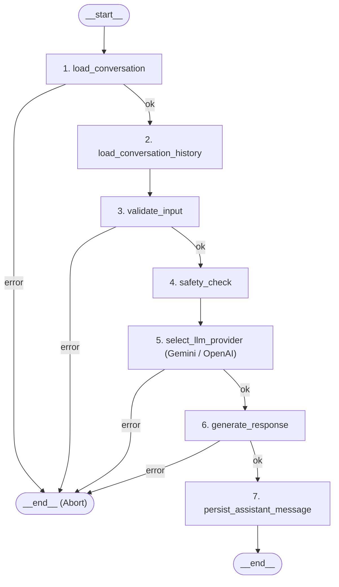
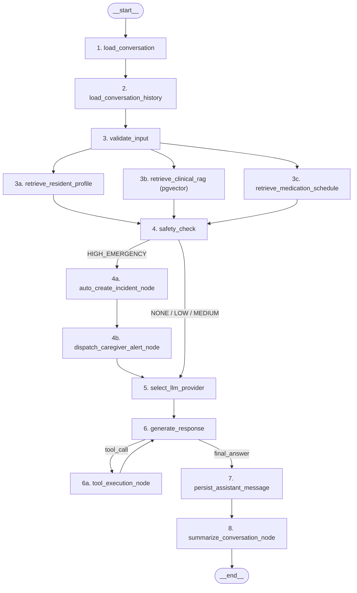

# 🧠 LLM Integration & LangGraph Architecture

This document details the modular Conversational AI & LangGraph orchestration layer implemented in `src/ai/`.

---

## 1. Architectural Principles

1. **Provider Decoupling (`BaseLLMProvider`):** The application never directly couples route handlers or database logic to a specific vendor SDK. All LLM interactions go through `BaseLLMProvider` (`src/ai/providers/base.py`) and `LLMProviderFactory` (`src/ai/providers/factory.py`).
2. **Multi-Provider Support:**
   - **Google Gemini (`GeminiProvider`)** via `google-genai` (`gemini-2.0-flash`, `gemini-1.5-flash`, `gemini-1.5-pro`).
   - **OpenAI (`OpenAIProvider`)** via `openai` (`gpt-3.5-turbo`, `gpt-3.5-turbo-0125`, `gpt-4o-mini`).
3. **Stateful Graph Orchestration (`LangGraph`):** Every chat turn runs through a compiled `StateGraph` (`src/ai/graph/workflow.py`) with explicit nodes, typed state (`ChatGraphState`), and conditional failure-gate edges.
4. **Atomic Persistence:** User and Assistant messages are persisted together in `persist_assistant_message_node` *only after* upstream validation and LLM generation succeed, preventing orphaned user turns on network/rate-limit errors.

---

## 2. First (Implemented) LangGraph Workflow



### Node Responsibilities (`src/ai/graph/nodes.py`)

| Node | Responsibility |
|---|---|
| `1. load_conversation` | Loads `Conversation` and `Resident` from DB, verifies `status == "active"`, and resolves default `provider` and `model`. |
| `2. load_conversation_history` | Loads the sliding window of recent messages (`CHAT_MAX_HISTORY_MESSAGES`, default 20) ordered chronologically. |
| `3. validate_input` | Trims and validates `user_input` length and non-empty constraints. |
| `4. safety_check` | Screens `user_input` via `SafetyChecker` (`src/ai/safety/checker.py`) for high-emergency indicators (falls, chest pain, stroke, self-harm) and medium clinical concerns (sleep, medication, dizziness). Injects a `safety_directive` into the state when triggered. |
| `5. select_llm_provider` | Uses `LLMProviderFactory` to instantiate `GeminiProvider` or `OpenAIProvider`, verifies API key availability, and validates the requested model name. |
| `6. generate_response` | Builds the Elderly Care Companion system prompt (`build_elderly_care_system_prompt`), attaches resident context and safety directives, and calls `provider.generate()`. |
| `7. persist_assistant_message` | Atomically writes the user `Message` and assistant `Message` to PostgreSQL/SQLite, storing `provider`, `model`, `token_usage`, `latency_ms`, and `safety` metadata in `Message.extra_metadata` and updating `Conversation.extra_metadata`. |

---

## 3. Final (Target Extensible) LangGraph Architecture

The graph is designed so future clinical capabilities plug directly between existing nodes:



---

## 4. Environment Configuration

Configure LLM providers in `.env` (see `.env.example`):

```dotenv
DEFAULT_LLM_PROVIDER=gemini
GEMINI_API_KEY=your_gemini_api_key_here
GEMINI_DEFAULT_MODEL=gemini-2.0-flash

OPENAI_API_KEY=your_openai_api_key_here
OPENAI_DEFAULT_MODEL=gpt-3.5-turbo

CHAT_MAX_HISTORY_MESSAGES=20
CHAT_DEFAULT_TEMPERATURE=0.4
CHAT_DEFAULT_MAX_TOKENS=1024
```

